# Awesome 3D Texture Painting Software 🎨🖌️

  

  
  
  
  
  
  
  

---

## 🌟 Top 3D Texture Painting Software Ecosystem

> **Curated directory of industry-leading SaaS platforms and open-source GitHub projects for 3D texture painting, Physically Based Rendering (PBR) workflows, procedural surface authoring, and mesh UV texturing.** 🚀

**Last updated: October 2026** 📅

This repository tracks notable **SaaS platforms** and **open-source repositories** for **3D Texture Painting Software**. These tools enable 3D artists, technical directors, and game developers to paint directly onto 3D polygon meshes—authoring base color (albedo), roughness, metallic, normal, ambient occlusion (AO), and displacement/height maps through layer stacks, smart masks, procedural node graphs, and GPU baking pipelines for AAA games, cinematic VFX, VR/AR, and industrial product visualization.

**Category Leaders**: Adobe Substance 3D Painter, Foundry Mari, 3D-Coat, Blender, and ArmorPaint.

---

## 📑 Table of Contents

- [📊 Sector Overview & Market Dynamics](#-sector-overview--market-dynamics)
- [💼 SaaS & Commercial Hosted Platforms](#-saas--commercial-hosted-platforms)
- [🔓 Open-Source GitHub Projects](#-open-source-github-projects)
- [🤝 How to Contribute](#-how-to-contribute)
- [💖 Support & Sponsorship](#-support--sponsorship)
- [📈 Star History](#-star-history)
- [⚠️ Disclaimer](#️-disclaimer)

---

## 📊 Sector Overview & Market Dynamics

The dedicated 3D texture painting and surface authoring software sector is estimated at **$250 million to $500 million** (nested within the broader **$30B+ digital content creation market**, expanding at ~10–12% CAGR driven by gaming, VFX, virtual production, and real-time 3D pipelines). Market dynamics are **highly concentrated and near 'winner-take-all'**, where Adobe (Substance 3D Painter) commands near-ubiquitous industry-standard status for PBR texturing across games and general 3D, complemented by Foundry Mari in high-end VFX film pipelines and Autodesk/Maxon in adjacent sculpting and modeling suites, leaving independent studios to compete on perpetual licensing and niche performance.

---

## 💼 SaaS & Commercial Hosted Platforms

| 🏷️ Product | 🏢 Company Scale (Valuation / Revenue) | 📝 Description | 💳 Pricing | 🎁 Free Tier Limit |
| :--- | :--- | :--- | :--- | :--- |
| **[Adobe Substance 3D Painter](https://www.adobe.com/products/substance3d/apps/painter.html)** | **~$95B – $100B Market Cap** (~$21B+ annual revenue) | Industry-standard PBR texture painting with smart materials, smart masks, and particle brushes. | **US$23.99/mo** (promotional individual plan) or **US$24.99/mo** standalone texturing / **US$119.99/mo** per license for teams; Steam one-time purchase at **$199.99**. | **30-day free trial** with full functionality across desktop apps; no permanent free tier. |
| **[Mudbox (Autodesk)](https://www.autodesk.com/products/mudbox/)** | **~$50B – $54B Market Cap** (~$5.5B+ annual revenue) | Digital sculpting and texture painting tool for detailed characters. | **$10/month** or **$100/year** (subscription-based). | **30-day free trial** for evaluation only (no commercial use allowed); verified educators/students receive 1-year renewable academic access. |
| **[ZBrush (Maxon)](https://www.maxon.net/en/zbrush)** | **~$9.5B Parent Market Cap** (Nemetschek SE; Maxon revenue ~$65M–$70M/yr) | Sculpting suite with **Polypaint** for vertex-color painting directly on high-poly meshes. | **$33.25/month** billed annually ($399/year) or **$49/month** billed monthly. | **14-day free trial** of Maxon One/ZBrush (single user/device, non-extendable); separate permanent free iPad basic version capped at 28 brushes. |
| **[Mari (Foundry)](https://www.foundry.com/products/mari)** | **~$85M Annual Revenue** (Private equity-backed studio tooling) | High-end texture painting for VFX and film, handling massive texture counts and UDIM workflows. | **$86/month** or **$689/year** for individual subscription; studio enterprise licenses higher. | **Permanent Non-Commercial Free Edition** (strictly non-commercial, export capped at 4K resolution, 16-bit color, and maximum 6 UV tiles/UDIM patches per object). |
| **[3D-Coat](https://3dcoat.com/)** | **Bootstrapped / Private Studio** (Pilgway, estimated <$10M revenue) | Sculpting, retopology, and texture painting suite with a one-time purchase model. | **€20.80/month** subscription, **€41.60/month** rent-to-own (11 months), or **€379** permanent license. | **30-day free trial** with full features; transitions to permanent **Free Learning Mode** capped at 20 sculpt objects, 10 layers, 512x512 texture exports (or watermarked higher res), and non-commercial use only. |

---

## 🔓 Open-Source GitHub Projects

Curated open-source 3D texturing engines, procedural material generators, and neural texture projection tools, sorted descending by GitHub star popularity:

1. **[Blender](https://github.com/blender/blender)**  🎨  
   **The comprehensive open-source 3D creation suite with native Texture Painting.**  
   Blender features a complete Texture Paint workspace letting artists paint color, roughness, bump, and normal passes directly onto 3D models with customizable brushes, stencils, symmetry, and projection mapping. Seamlessly integrates with EEVEE/Cycles shaders, UV unwrapping, and geometry node pipelines.  
   - **Key Features**: Direct 3D mesh brush projection, clone and stencil brushes, layer-friendly shader node tree, zero licensing cost.

2. **[Dream Textures](https://github.com/carson-katri/dream-textures)**  🪄  
   **AI-assisted texture generation add-on for Blender powered by Stable Diffusion.**  
   Integrates diffusion models directly within Blender's shader editor and 3D viewport. Allows artists to generate seamless tiling PBR maps, project textures with depth-awareness, and inpaint mesh regions using natural language prompts.  
   - **Key Features**: Text-to-texture, depth-to-image projection, seamless PBR texture synthesis, interactive inpainting.

3. **[Material Maker](https://github.com/RodZill4/material-maker)**  🧬  
   **Node-based procedural PBR texture generator and 3D model painter based on Godot Engine.**  
   Material Maker combines the procedural node-graph power of Substance Designer with Substance Painter's direct 3D mesh brush painting. Author complex procedural patterns and paint directly onto multi-material 3D meshes using layers, masks, and custom brush shaders.  
   - **Key Features**: Procedural graph authoring, 3D painting viewport with layer stack, Godot/Unity/Unreal export presets.

4. **[ArmorPaint](https://github.com/armory3d/armorpaint)**  🛡️  
   **Dedicated stand-alone PBR texture painting software with GPU acceleration.**  
   Written in C and DScript, ArmorPaint provides a fast, ray-traced, node-based 3D painting workflow. Features high-resolution layer stacks, mask workflows, procedural materials, and a built-in GPU texture baker for ambient occlusion, curvature, normal, and height extraction.  
   - **Key Features**: Real-time PBR viewport, GPU map baking, node-based smart materials, iPad/Android touch support.

5. **[Materialize](https://github.com/BoundingBoxSoftware/Materialize)**  🧱  
   **Standalone tool for converting 2D photographs into full PBR material map sets.**  
   Built with Unity, Materialize allows artists to generate diffuse, height, normal, metallic, smoothness, and ambient occlusion maps from a single input photograph, with interactive previewing on custom 3D meshes.  
   - **Key Features**: Rapid photo-to-PBR map generation, seamless edge tiling generation, real-time material preview.

6. **[AwesomeBump](https://github.com/kmkolasinski/AwesomeBump)**  ⚡  
   **GPU-accelerated open-source alternative to CrazyBump and InsaneBump.**  
   An image-to-PBR converter developed with Qt and OpenGL. Generates normal, depth/height, specular, ambient occlusion, and roughness maps with fast real-time GPU computation and 3D preview tessellation.  
   - **Key Features**: GPU processing, normal map orientation fine-tuning, 3D mesh preview with parallax occlusion mapping.

7. **[InkPainter](https://github.com/EsProgram/InkPainter)**  🖋️  
   **Runtime and editor-time texture painting engine for Unity 3D.**  
   Allows developers to paint directly onto skinned meshes, static colliders, and objects in real time using shader-based texture blitting. Widely utilized for dynamic splatting, character damage decals, and in-game brush interactions.  
   - **Key Features**: Unity shader-based canvas painting, support for height and normal deformation, performant dynamic decals.

8. **[Paint3D](https://github.com/OpenTexture/Paint3D)**  🤖  
   **Coarse-to-fine neural 3D texture synthesis using lighting-less diffusion models (CVPR 2024).**  
   Generates high-resolution, unshaded 2K UV texture maps for arbitrary 3D geometry from text descriptions or reference images. Overcomes baked lighting artifacts by synthesizing pure albedo textures ready for game engines.  
   - **Key Features**: Lighting-less texture diffusion, coarse-to-fine UV inpainting, multi-view consistency.

9. **[Diffusion Texture Painting](https://github.com/nv-tlabs/DiffusionTexturePainting)**  🔬  
   **Interactive direct 3D surface painting powered by 2D diffusion models (SIGGRAPH 2024 / NVIDIA Research).**  
   Enables interactive localized texture painting onto 3D surfaces with generative priors. Artists brush over arbitrary regions on a 3D mesh to synthesize coherent texture details seamlessly blended with surrounding geometry.  
   - **Key Features**: Interactive brush-driven diffusion, seamless UV-space blending, view-conditioned generative texturing.

---

## 🤝 How to Contribute

Contributions are warmly welcomed! Help keep this 3D texturing ecosystem updated:

1. 🍴 **Fork** this repository.
2. 🌿 **Create a new branch**: `git checkout -b feature/add-new-tool`.
3. ✏️ **Add or edit entries** in `README.md` following the established table and Stars_Badge formatting.
4. 🔗 Ensure all URLs, GitHub repositories, and pricing details are verified.
5. 🚀 **Submit a Pull Request** with a brief summary of the added tool.

---

## 💖 Support & Sponsorship

If you find this curated collection useful for your 3D pipeline, game development studio, or research workflow, please consider supporting this project! ✨

- ⭐ **Star this repository** to improve discoverability for fellow 3D artists and developers.
- 🍴 **Fork and share** with your creative team, game jam peers, or graphics community.
- ☕ **Buy me a coffee / Sponsor**: Support ongoing maintenance, research, and curation through the **[GitHub Sponsors Dashboard](https://github.com/sponsors/ishandutta2007)**. Every sponsorship helps keep open-source resource lists active and high quality! 💖

---

## 📈 Star History

---

## ⚠️ Disclaimer

- This is a **community-curated directory** provided for educational and informational purposes; inclusion does not imply official endorsement.
- **ArmorPaint** offers a full open-source codebase for self-compilation, while convenient precompiled binaries are available on its store.
- **Quixel Mixer** has been transitioned to maintenance/offline status following Epic Games ecosystem realignments; verify compatibility before relying on it for new pipelines.
- **Mari Non-Commercial Edition** is strictly capped at 4K resolution, 16-bit color, and 6 UDIM patches per object.
- **Adobe Substance 3D** pricing regularly fluctuates with promotional discounts and bundle packages; consult official vendor portals for current studio enterprise billing.

---

  <b>Crafted with ❤️ for 3D artists, technical directors, and graphics developers.</b> 
  Let's make 3D texture painting, layered PBR workflows, and digital content creation accessible to everyone.

